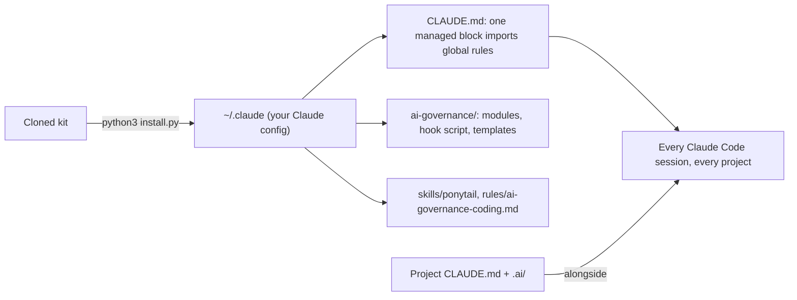

# AI Governance Starter Kit

**One installation. Consistent standards. Every project.**

A portable, open-source governance foundation for Claude Code and AI-assisted software development.

## Get started in 4 steps
**You need:** Python 3.8+ (`python3 --version`, Windows `py -3 --version`), Git (only to clone), and Claude Code in VS Code (only for step 4).
**Cloning does not activate anything.** Rules become active when you run `install.py` and start a new Claude Code session.

**1. Download or clone** (or unzip the ZIP from [Releases](https://github.com/infodhorvath-sudo/AI-GOVERNANCE-STARTER-KIT/releases); in VS Code: `Git: Clone` from the Command Palette)
```bash
git clone https://github.com/infodhorvath-sudo/AI-GOVERNANCE-STARTER-KIT.git
cd AI-GOVERNANCE-STARTER-KIT
```
**2. Preview, then install** (the dry run writes nothing; add `--hooks` only if you want the optional START/END hook)

| macOS / Linux | Windows (PowerShell) |
|---|---|
| `python3 install.py --dry-run` | `py -3 install.py --dry-run` |
| `python3 install.py` | `py -3 install.py` |

**3. Verify the files**

| macOS / Linux | Windows (PowerShell) |
|---|---|
| `python3 verify.py` | `py -3 verify.py` |

**4. Confirm in VS Code:** restart VS Code, open Claude Code in a new conversation in any project and ask
**"What is the AI Governance canary?"** Expected answer: `AIGOV-KIT-1.0.0-LOADED`.

Your existing configuration is preserved and everything can be undone with `python3 install.py --rollback`.
New to this? The **[illustrated step-by-step installation guide](docs/INSTALLATION-GUIDE.md)** covers cloning in VS Code, ZIP install, expected output, troubleshooting, updating and uninstalling.

## Why this exists
AI coding assistants are powerful, but each session starts from scratch. Without shared rules you end up
re-explaining the same expectations in every repository, and results drift: unrequested changes, lost context
between sessions, inconsistent Git habits, unnecessary token spend, and no standard way to start a new project.

The kit gives every project the same small, readable baseline, installed once at the user level, so you stop copy-pasting
instructions. Your projects keep their own rules; the global layer only supplies the common ground.

## What you get
| Piece | What it is | How it activates |
|---|---|---|
| Global rules | Authority order, autonomy with safety gates, Git/evidence discipline, definition of done | Automatic, every project |
| Coding rule | "Smallest correct solution" standard (Ponytail-style) | Automatic, every project |
| Modules | Session lifecycle (START/END handoff), Git and safety, cost and review | On demand: read only when a task needs them |
| `ponytail` skill | Third-party MIT skill for lean coding | On demand |
| START/END hook | Reminder injected when you send exactly `start`/`end`/`finish` | Optional: `--hooks` |
| Project bootstrap | Creates a project `CLAUDE.md` and `.ai/STATE.md` + `SESSION-LOG.md` | Optional, per project |
| Installer tooling | Dry-run, backup, safe merge, idempotent re-install, rollback, `verify.py` | You run it |

Defaults are conservative: **no automatic commits or pushes**, no network access, no telemetry, no background process.

## How it works

Cloning is not installing: `install.py` adds one managed block to your `~/.claude/CLAUDE.md` (an `@import` of the
global rules, with a path generated on your machine) and copies the rest into your Claude config directory.
You never move the repository into `~/.claude`. Anything it would replace is backed up first; your own content is not touched.

**Advisory vs. enforced.** The rules are instructions to a language model: they steer behavior but cannot guarantee it.
The deterministic parts are the installer, the verifier and the optional hook (which only injects text). Nothing here sandboxes the assistant.

## Verify installation
`python3 verify.py` reports four separate levels with explicit statuses
(`PASS`, `FAIL`, `NOT INSTALLED`, `NOT TESTED`, `MANUAL VERIFICATION REQUIRED`):

1. package integrity (checksums, no secrets, required files),
2. isolated sandbox install/update/rollback/failure tests (never touches your config),
3. installation state in your real config,
4. runtime loading in Claude Code.

Exit code: `1` = a failure, `2` = not installed yet, `0` = all good.
File checks cannot prove the assistant actually loads the rules. After installing, restart VS Code, open Claude Code in any
project and ask **"What is the AI Governance canary?"** — expected answer `AIGOV-KIT-1.0.0-LOADED`. Steps in
[docs/VERIFY-IN-VSCODE.md](docs/VERIFY-IN-VSCODE.md); `python3 verify.py --live` automates it with three tiny Haiku requests on your own login.

## Create a new project
Optional; global rules already apply to every project without it.
```bash
python3 ~/.claude/ai-governance/bootstrap-project.py ./my-project --name "My Project"
```
Windows: `py -3 "%USERPROFILE%\.claude\ai-governance\bootstrap-project.py" .\my-project --name "My Project"`

Creates `CLAUDE.md` (commands, project rules, Git policy), `.ai/STATE.md` and `.ai/SESSION-LOG.md`. Never overwrites existing files and never copies the global rules.
Then `START` resumes from `.ai/STATE.md` and `END` checkpoints it.

## Customize the rules
- Your own global rules: put them in `~/.claude/CLAUDE.md` outside the managed block, or in your own file in `~/.claude/rules/`. Updates never touch these.
- Project rules: the project's `CLAUDE.md`. Claude Code combines user and project files; the kit tells Claude that project rules win, so keep them consistent.
- Enable auto-push for one project: add the `Auto-push:` line described in `~/.claude/ai-governance/modules/AUTONOMY-GIT-SAFETY.md` to that project's `CLAUDE.md`.
- Do not edit kit-owned files (`~/.claude/ai-governance/`, the kit's rule file, the kit's skill): the next install replaces them
  (the old copy stays in the backup). To change kit defaults permanently, fork this repository.

## Updating
```bash
git pull --ff-only
python3 install.py --dry-run
python3 install.py
python3 verify.py
```
Pulling changes nothing in your Claude config; only `install.py` does, and it is tested to update an earlier installation:
kit-owned files are replaced, the managed block is refreshed in place (no duplicate import), your own content is preserved, and a new backup is made.

## Uninstall / rollback
```bash
python3 install.py --list-backups
python3 install.py --rollback --dry-run
python3 install.py --rollback           # restores the state before the last change, removes what the kit created
```
Manual steps without Python: [docs/ROLLBACK.md](docs/ROLLBACK.md). A failed installation undoes itself automatically.

## Supported platforms and tools
| Target | Status |
|---|---|
| macOS + Claude Code CLI/VS Code | Installer, rollback and update **tested** in isolated sandboxes; runtime loading in the VS Code extension **manual verification required** |
| Linux | Statically validated only (same POSIX code path), not run on Linux |
| Windows | Statically validated only (hook command, paths with spaces/backslashes); not run on real Windows |
| Cursor, Codex, Gemini CLI, other assistants | **Not supported**; adapters are only a possible future direction |

Anthropic documents user-level `CLAUDE.md`, `@` imports, `~/.claude/rules/`, user skills, hooks and `CLAUDE_CONFIG_DIR` for Claude Code.
Sharing of all of these with the VS Code extension is explicitly documented only for `settings.json`, hence the manual check above.

## Security and privacy
Local only: no network calls, no telemetry, no accounts. The installer writes only inside your Claude config directory, never reads or copies
authentication files, never changes permissions, and backs up before every change. Details and reporting: [SECURITY.md](SECURITY.md).
Read `install.py --dry-run` output before installing; the whole kit is a few hundred lines of plain Python and Markdown.

## Contributing
See [CONTRIBUTING.md](CONTRIBUTING.md). Small, dependency-free, tested changes are the best fit. Release history: [CHANGELOG.md](CHANGELOG.md).

## Roadmap (possibilities, not promises)
- v1.x: better install diagnostics, more example configurations, real Linux/Windows test reports, friendlier update conflict handling.
- v2.x: optional adapters for other AI coding assistants, each implemented and tested separately.
- v3.x: optional multi-agent conventions, model-routing policies, configurable quality gates.

## License
[MIT](LICENSE) © 2026 Daniel Horvath. The vendored Ponytail skill is MIT © 2026 DietrichGebert; see
[THIRD-PARTY-NOTICES.md](THIRD-PARTY-NOTICES.md).
