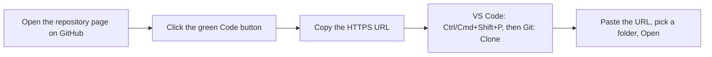
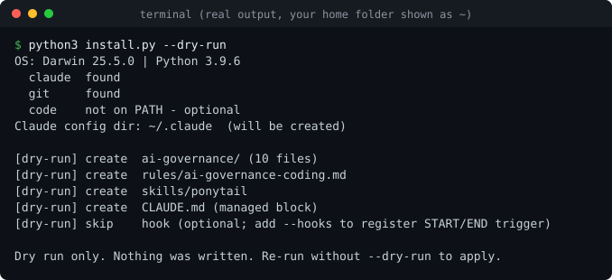
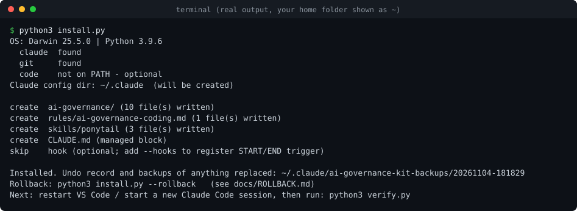
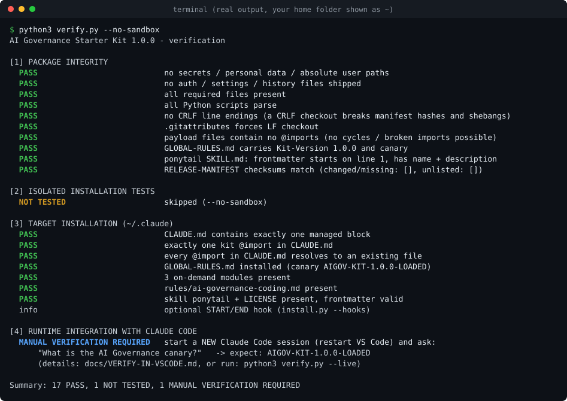
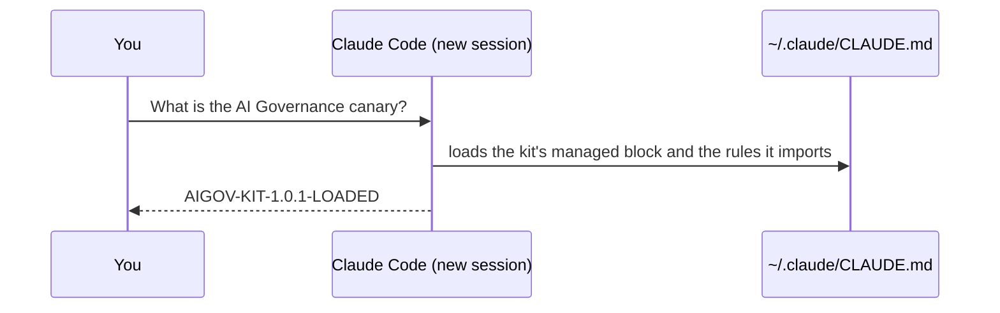

# Installation guide (step by step)

For people who have never used this kit. About 10 minutes. Everything happens on your own computer.

**What the kit does:** it installs a small set of shared engineering rules into Claude Code's *user-level*
configuration, so every project you open inherits them (safe Git habits, "smallest correct change", cost-aware model use, an optional
session handoff). The rules are written instructions for the AI model: they guide it, they do not force it.

**Important:** downloading or cloning this repository does **not** activate anything. Rules become active only after you run
`install.py` (step 3) and start a *new* Claude Code session (step 6).

**What happens to your existing setup:** nothing is overwritten. `install.py --dry-run` first shows the plan without writing. The real run
adds one clearly marked block to `~/.claude/CLAUDE.md`, copies kit files into their own folders, backs up whatever it replaces, and can be fully undone.

> About the images: the three terminal pictures below are rendered from **real output** of the commands in this guide (run in a throwaway home
> directory; your home folder is displayed as `~`). The two diagrams are **illustrative**, not screenshots. No screenshot of an authenticated
> Claude Code session is included; see [step 6](#6-confirm-claude-code-loads-the-rules) for what you should see.

## 1. Prerequisites
| Need | Check with | Notes |
|---|---|---|
| Python 3.8 or newer | macOS/Linux: `python3 --version` — Windows: `py -3 --version` | Get it from https://www.python.org/downloads/ . No packages to install. |
| Git (only to clone) | `git --version` | Not needed for the ZIP route. |
| Claude Code in VS Code | open VS Code → Extensions → "Claude Code" | Must be installed and signed in. Needed for step 6 only; the installer does not need it. |

## 2. Get the kit

### Option A (recommended): clone from GitHub

*Illustrative diagram of the flow, not a screenshot.*

1. Open https://github.com/infodhorvath-sudo/AI-GOVERNANCE-STARTER-KIT .
2. Click the green **Code** button and copy the HTTPS URL (`https://github.com/infodhorvath-sudo/AI-GOVERNANCE-STARTER-KIT.git`).
3. In VS Code open the Command Palette (**Ctrl+Shift+P**, macOS **Cmd+Shift+P**), type `Git: Clone`, paste the URL, choose a parent folder, and click **Open** when VS Code offers to open the clone.
4. Open VS Code's built-in terminal: **Terminal → New Terminal** (shortcut **Ctrl+`**). It starts inside the cloned folder.

Prefer the command line instead? In any terminal:
```bash
git clone https://github.com/infodhorvath-sudo/AI-GOVERNANCE-STARTER-KIT.git
cd AI-GOVERNANCE-STARTER-KIT
```
Keep the folder anywhere you like. You do **not** put it inside `~/.claude`.

### Option B: ZIP (no Git needed)
1. Open the [Releases page](https://github.com/infodhorvath-sudo/AI-GOVERNANCE-STARTER-KIT/releases), download `AI-GOVERNANCE-STARTER-KIT-v1.0.1.zip` (optional: compare it with the published `.sha256` file).
2. Unzip it. You get a folder named `AI-GOVERNANCE-STARTER-KIT`.
3. In VS Code: **File → Open Folder…**, choose that folder, then **Terminal → New Terminal**.

## 3. Preview, then install
All commands run in the terminal opened in the kit folder. Windows (PowerShell): use `py -3` where this guide says `python3`.

**3a. Dry run (recommended, writes nothing):**
```bash
python3 install.py --dry-run
```


You should see `create` lines for `ai-governance/`, `rules/ai-governance-coding.md`, `skills/ponytail` and `CLAUDE.md`, and the closing sentence
"Dry run only. Nothing was written." The first lines show your OS, Python version and which of `claude`, `git`, `code` were found (`code` missing is fine).
If you already have a `CLAUDE.md`, the line says `update` and "your content preserved". Same-named skills or rules of your own show up as `WARNING` and are skipped, never overwritten.

**3b. Install:**
```bash
python3 install.py
```


Add `--hooks` only if you want the optional START/END trigger (see [README](../README.md#what-you-get)). Without it nothing runs automatically.
Running the installer again is safe: it reports "Nothing to change - already up to date."

## 4. Verify the files
```bash
python3 verify.py
```
This checks the kit itself, runs install/update/rollback tests in a throwaway folder (your config is not touched), then inspects your real installation.
For a quicker run use `python3 verify.py --no-sandbox`, which is what the picture shows. In level 4 the real Claude Code CLI is asked what it loads (works without logging in):



If `claude` is not on your PATH, level 4 says `NOT TESTED`; that is fine, use step 6. Statuses: `PASS` good, `FAIL` a real problem (see [Troubleshooting](#troubleshooting)), `NOT INSTALLED` the kit is not installed in the target yet,
`NOT TESTED` skipped or impossible here, `MANUAL VERIFICATION REQUIRED` only you can confirm it (next steps). Exit code: `0` all good, `1` a failure, `2` not installed.

## 5. Restart VS Code
Close and reopen VS Code (or run **Developer: Reload Window**). Claude Code reads the user-level configuration when a new session starts.

## 6. Confirm Claude Code loads the rules
File checks cannot prove that Claude actually *reads* the rules, so test it:

1. Open any project folder in VS Code and open Claude Code (a new conversation).
2. Ask exactly: **What is the AI Governance canary?**
3. Expected answer: `AIGOV-KIT-1.0.1-LOADED`


*Illustrative diagram of the expected result, not a screenshot of a real session.*

Optional extra checks: type `/memory` (lists the loaded CLAUDE.md files) or `/context`; type `/` and look for the `ponytail` skill.
A project's own `CLAUDE.md` works alongside the global rules: add a line like `Project canary code: ZEBRA-1` to it and ask for both canaries.
Prefer a script? `python3 verify.py --live` runs this check with three tiny Haiku requests on your own login.
Full acceptance checklist, including what each test does and does not prove: [VERIFY-IN-VSCODE.md](VERIFY-IN-VSCODE.md). If you do not see the expected answer, go to [Troubleshooting](#troubleshooting).

## 7. Start a new project (optional)
Global rules already apply to every project. To also create project-level instructions and a session handoff file:
```bash
python3 ~/.claude/ai-governance/bootstrap-project.py ./my-project --name "My Project"
```
Windows: `py -3 "%USERPROFILE%\.claude\ai-governance\bootstrap-project.py" .\my-project --name "My Project"`.
It creates `CLAUDE.md`, `.ai/STATE.md` and `.ai/SESSION-LOG.md` and never overwrites an existing file.

## Update the kit
```bash
git pull --ff-only
python3 install.py --dry-run
python3 install.py
python3 verify.py
```
Pulling changes nothing in Claude's configuration; only `install.py` does. It replaces kit-owned files, refreshes the managed block in place (no duplicates),
keeps your own content, and makes a new backup. ZIP users: unzip the new release and run the same `install.py` commands.
If you edited a kit file under `~/.claude/ai-governance/`, the update keeps your version and prints a warning (use `--force` to replace it; a backup is made). Put your own rules outside the managed block of `~/.claude/CLAUDE.md` or in your own `~/.claude/rules/` file to avoid any conflict.

## Uninstall / undo
```bash
python3 install.py --list-backups
python3 install.py --rollback --dry-run
python3 install.py --rollback
```
Each `--rollback` undoes the **most recent** change (restoring replaced files exactly and deleting what the kit created). After several updates, repeat it to step further back.
No Python? Follow the manual steps in [ROLLBACK.md](ROLLBACK.md). Restart VS Code afterwards.

## Common mistakes
- **Cloning and expecting it to work.** Cloning only downloads the files. Run `install.py`.
- **Skipping the restart.** An already-open Claude Code session keeps its old configuration. Start a new session.
- **Moving the repository into `~/.claude`.** Not needed and not supported; keep it anywhere else.
- **Using `python3` on Windows.** Use `py -3` (or `python`).
- **Editing kit files under `~/.claude/ai-governance/`.** Allowed, but updates will then keep your version and warn instead of applying the new one. Prefer your own rules file.

## Troubleshooting
| Symptom | Cause / fix |
|---|---|
| `python3: command not found` (Windows: "Python was not found") | Install Python 3.8+ from python.org. On Windows use `py -3`; if the Microsoft Store opens, disable the "python" app alias in Settings → Apps → Advanced app settings → App execution aliases, or just use `py -3`. |
| `git clone` says repository not found / asks for login | Check the URL character by character. The repository is public and needs no login. |
| `Permission denied` for `./install.sh` | Run `python3 install.py` directly. |
| `WARNING: ... was modified by you since install; KEPT` | You edited a kit file; the installer protects your edit. Merge the new text by hand, or run `python3 install.py --force` to replace it (backup kept). |
| `WARNING: skills/ponytail already exists ...` or `rules/... skipped` | You already have a different item with that name. The kit leaves it untouched; the kit's version is simply not installed. Rename yours if you want the kit's. |
| `WARNING: settings.json is not valid JSON; hook NOT registered` | Your `settings.json` has a syntax error, so the installer left it alone. Fix it, rerun with `--hooks`. |
| `ERROR: installation failed ...` | The installer undid its partial work automatically; your configuration is as before. Read the message (often a permissions or "not a directory" problem), fix it, rerun. |
| `verify.py` exit code `2`, status `NOT INSTALLED` | Not a failure: you have not run `python3 install.py` yet (or used another config folder; pass `--claude-dir`). |
| `FAIL ... RELEASE-MANIFEST checksums` | A file in the kit folder was modified or has different line endings. Re-clone or re-download; do not edit kit files. |
| Claude does not answer with the canary | 1) Restart VS Code and use a *new* conversation. 2) Run `python3 verify.py` and check the target section is all PASS. 3) Open `~/.claude/CLAUDE.md` and confirm the block between `BEGIN`/`END AI-GOVERNANCE-STARTER-KIT` exists. 4) Use `/memory` to see which files are loaded. 5) If everything checks out, the extension may not load user-level files in your version: please open an issue with your VS Code and extension versions. |
| `claude not on PATH` in installer output | Harmless; the VS Code extension bundles Claude Code. Only `verify.py --live` needs the `claude` command. |

Still stuck? Open an issue: https://github.com/infodhorvath-sudo/AI-GOVERNANCE-STARTER-KIT/issues (include OS, Python version and the output of `python3 verify.py`; remove personal paths first).
